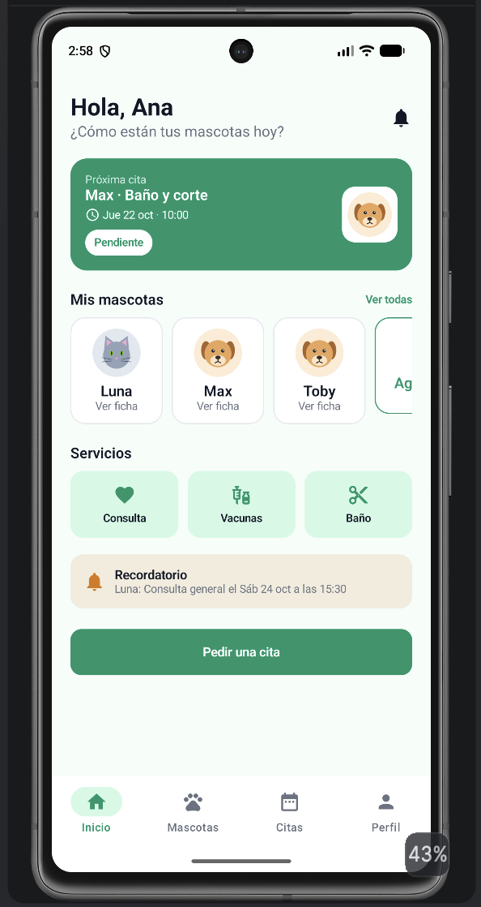
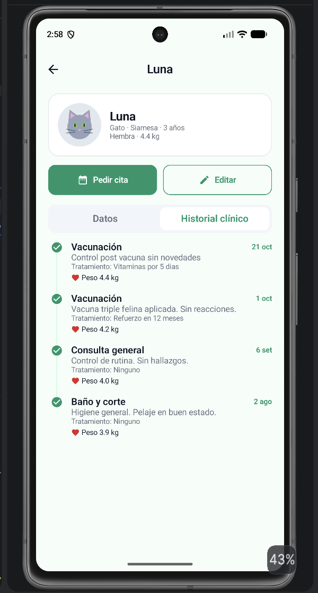
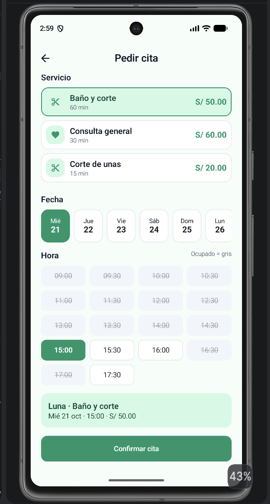
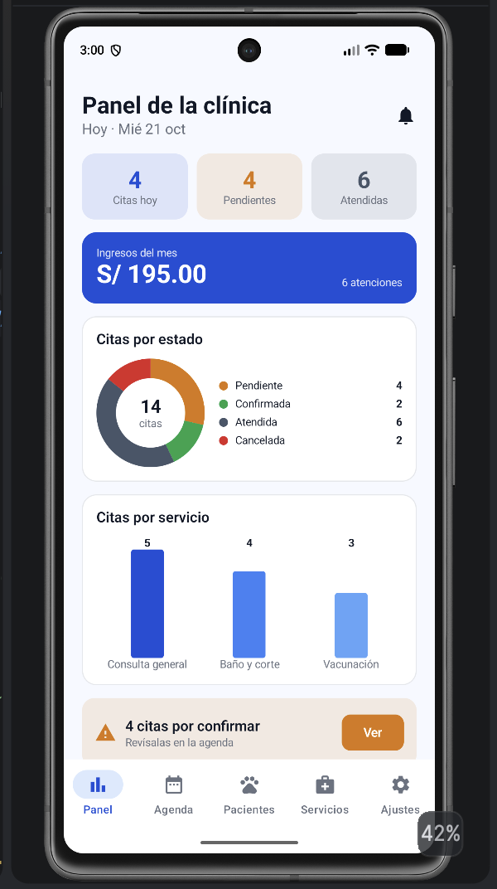
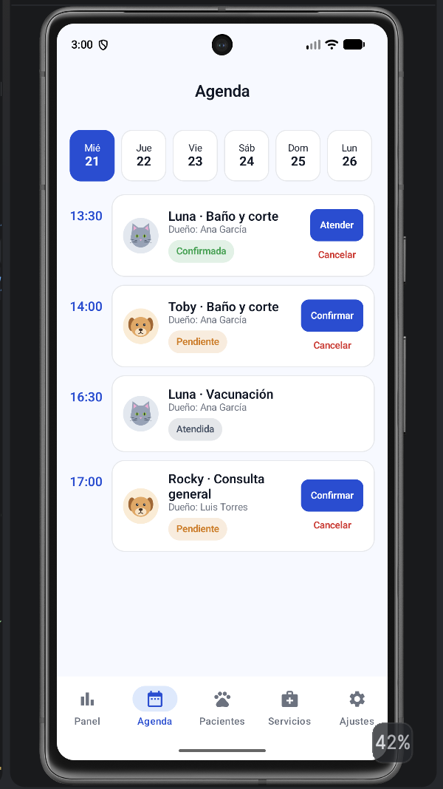
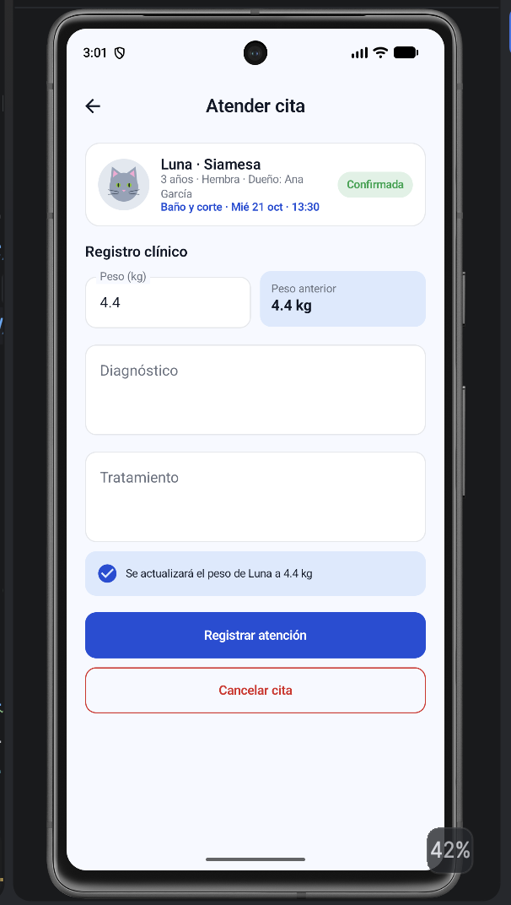

# HuellitasVet

App Android de una veterinaria construida con **Kotlin + Jetpack Compose + Material 3**, **Room**, **DataStore** y **Navigation Compose**, siguiendo el patrón **MVVM + Repository (interface)**.

Tiene dos perfiles que comparten la misma base de datos Room en el dispositivo:

- **Dueño (verde):** registra a sus mascotas, pide citas eligiendo servicio, fecha y hora, cancela citas (hasta 2 horas antes) y consulta el historial clínico de cada mascota.
- **Veterinario (azul):** ve el panel con contadores, ingresos y gráficos, maneja la agenda del día (confirmar, atender, cancelar), registra la atención clínica (diagnóstico, tratamiento y peso), consulta a los pacientes y administra los servicios.

Cuando el veterinario registra una atención, el dueño la ve al instante en el historial de su mascota (Flow de Room).

**Autor:** Lucas Inga Marín · Programación en Móviles · Tecsup

## Cuentas de prueba (datos ficticios)

| Perfil | Correo | Clave |
|---|---|---|
| Dueño | ana@correo.test | 1234 |
| Dueño | luis@correo.test | 1234 |
| Veterinario | vet@huellitas.test | admin |

## Tecnologías

- Kotlin, Jetpack Compose y Material 3 (sin XML)
- Room 2.8.4 con KSP (entidades, DAOs, relaciones anidadas y transacciones)
- DataStore Preferences (perfil activo, modo oscuro, notificaciones y aceptar citas)
- Navigation Compose (un grafo por perfil)
- Lifecycle ViewModel + StateFlow
- java.time (LocalDate, LocalTime, Duration), minSdk 26

## Arquitectura MVVM + Repository

```
VIEW (Composable)
  │ eventos (clics)       ▲ collectAsState()
  ▼                       │
VIEWMODEL (StateFlow + reglas de negocio)
  │ llama                 ▲ Flow / resultados
  ▼                       │
VetRepository (interface)
  │ la implementa
  ▼
VetRepositoryRoom ──► DAO ──► SQLite (huellitasvet.db)

DataStore (solo preferencias) ──► ViewModel
```

- La **View** solo conoce a su ViewModel.
- El **ViewModel** solo conoce la interface `VetRepository` (y `PreferenciasStore`).
- El **Repository** conoce a los DAOs.
- Lectura que actualiza la pantalla → `Flow`. Escritura o acción única → `suspend`.

## Estructura de paquetes

```
com.tecsup.huellitasvet
├── MainActivity.kt
├── VetApp.kt
├── data
│   ├── local
│   │   ├── entity      Servicio, Usuario, Mascota, Cita
│   │   ├── dao         ServicioDao, UsuarioDao, MascotaDao, CitaDao
│   │   ├── relation    MascotaConDueno, CitaConDetalle
│   │   ├── VetDatabase.kt
│   │   └── DatosIniciales.kt
│   ├── repository      VetRepository (interface), VetRepositoryRoom
│   └── prefs           PreferenciasStore (DataStore)
├── model               Rol, EstadoCita, Especie, Sexo, ConteoServicio, Horarios
├── viewmodel           VetViewModelFactory, SesionViewModel, InicioViewModel,
│                       MascotaViewModel, PedirCitaViewModel, MisCitasViewModel,
│                       PanelViewModel, AgendaViewModel, AtenderCitaViewModel,
│                       PacientesViewModel, ServiciosViewModel
└── ui
    ├── theme           Color, Type, Theme (VetTheme por rol + modo oscuro)
    ├── components      AppTopBar, VetButton, VetTextField, EstadoCitaChip,
    │                   MascotaAvatar (Canvas), CitaCard, FechaChip, HoraChip,
    │                   HistorialItem, IconoServicio, BarraInferior, Formatos
    │   └── graficos    DatoGrafico, GraficoDona, GraficoBarras
    ├── navigation      Rutas, NavVet
    ├── dueno           Splash, Login, Inicio, Mascotas, FormularioMascota,
    │                   FichaMascota, PedirCita, MisCitas, Perfil
    └── veterinario     Panel, Agenda, AtenderCita, Pacientes, Servicios,
                        FormularioServicio, Ajustes
```

## Base de datos (4 tablas)

| Tabla | Relación |
|---|---|
| usuarios | — |
| servicios | — |
| mascotas | N mascotas → 1 dueño (FK duenoId) |
| citas | N citas → 1 mascota (FK mascotaId) · N citas → 1 servicio (FK servicioId) · índice (fecha, hora) |

## Capturas

| Dueño | | |
|---|---|---|
|  |  |  |
| Inicio con próxima cita | Ficha con historial clínico | Pedir cita con horarios |

| Veterinario | | |
|---|---|---|
|  |  |  |
| Panel con gráficos e ingresos | Agenda del día | Atender cita (registro clínico) |
